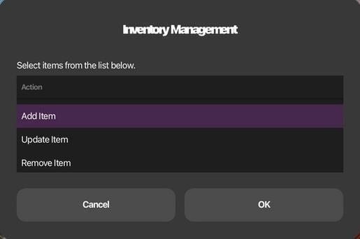
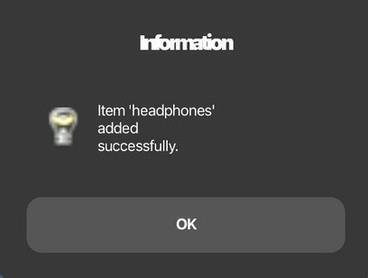
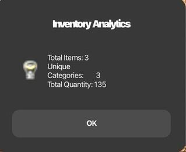
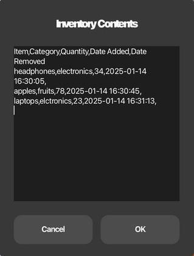
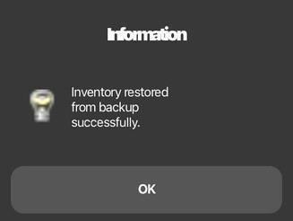

# Inventory Management System (Bash + Zenity)

A lightweight inventory management tool for UNIX/Linux, written in Bash with a [Zenity](https://help.gnome.org/users/zenity/stable/) graphical interface. Inventory data is stored in a plain CSV file, so the tool needs no database or extra runtime, just a standard shell and core UNIX utilities.

**Author:** [Priyam Thakur](https://github.com/priyamthakur275)

Built as an Alternative Assessment Tool (AAT) project for the **UNIX Shell Programming** course, Department of Computer Science and Engineering, B.M.S. College of Engineering, Bengaluru (2024–25).



## Features

| Feature | What it does |
|---|---|
| Create New File | Starts a fresh inventory CSV at a location chosen in a file dialog |
| Add Item | Prompts for name, category and quantity; stamps the date added |
| Update Item | Changes category and/or quantity; leaving a field blank keeps the current value |
| Remove Item | Deletes an item by name |
| Search Item | Looks up a single item |
| View Inventory | Shows the full inventory in a scrollable window |
| Generate Analytics | Total items, number of unique categories, total quantity |
| Export to HTML | Writes the inventory as an HTML table report |
| Backup / Restore | Automatic backup after every change, plus manual backup and one-click restore |
| Publish to AWS | Hosts the HTML report as a static website on Amazon S3 (see below) |

### Reliability and troubleshooting

- **Input validation:** rejects empty names, duplicate items (case-insensitive), commas that would break CSV columns, and quantities that are not positive integers.
- **Logging:** every action is recorded with a timestamp in `inventory.log`; every error goes to `inventory_error.log`. This makes it easy to trace what happened when something goes wrong.
- **Error handling:** file operations (write, backup, restore, export) check their exit status and report failures instead of silently continuing. Cancelling any dialog leaves the data untouched.
- **Safe file updates:** edits are written to a temporary file and then moved into place, so the same code works with both GNU (Linux) and BSD (macOS) tools.

## Screenshots

| Add item | Analytics | View inventory | Restore backup |
|---|---|---|---|
|  |  |  |  |

## Getting started

### Requirements

- Bash 3.2 or later (Linux or macOS)
- `zenity`
- Standard UNIX utilities: `awk`, `grep`, `cut`, `date`, `cp`, `mv`, `mktemp`
- Optional, for publishing: [AWS CLI v2](https://aws.amazon.com/cli/)

Install Zenity:

```bash
sudo apt install zenity      # Debian / Ubuntu
sudo dnf install zenity      # Fedora
brew install zenity          # macOS (Homebrew)
```

### Run

```bash
git clone <this-repo-url>
cd shell-inventory-management-system
chmod +x inventory.sh
./inventory.sh
```

Data files are created in the current directory. To keep them elsewhere:

```bash
INVENTORY_DATA_DIR=~/inventory ./inventory.sh
```

## Publish the report to AWS S3

`aws/deploy_report.sh` turns the current inventory into an HTML report and hosts it as a static website on Amazon S3, using the AWS CLI.

```bash
aws configure                                   # one-time: access key, secret, region
./aws/deploy_report.sh my-inventory-report-123  # default region: ap-south-1 (Mumbai)
```

The script:

1. Checks that the AWS CLI is installed and the credentials are valid (`aws sts get-caller-identity`).
2. Generates `index.html` from `inventory.csv`, reusing the HTML generator in `inventory.sh`.
3. Creates the bucket if it doesn't exist, handling the `us-east-1` region rule.
4. Applies a public-read bucket policy and enables static website hosting.
5. Uploads the report and prints the website URL.

Every step is logged with a timestamp to `deploy.log` and fails with a clear message. Re-run it after changing the inventory to update the live page.

To clean up and avoid any charges:

```bash
./aws/deploy_report.sh --delete my-inventory-report-123
```

The IAM user needs S3 permissions (for a personal test account, `AmazonS3FullAccess`). S3 static hosting is covered by the AWS Free Tier.

## Data format

`inventory.csv`:

```
Item,Category,Quantity,Date Added,Date Removed
Laptop,electronics,20,2025-01-14 13:12:26,
Apple,fruits,50,2025-01-14 13:17:59,
```

Files created at runtime:

| File | Purpose |
|---|---|
| `inventory.csv` | Current inventory |
| `inventory_backup.csv` | Latest backup, refreshed after every change |
| `inventory.log` | Timestamped action log |
| `inventory_error.log` | Timestamped error log |

## Tests

The test suite runs without a display. A mock `zenity` placed first on `PATH` replays scripted answers, so every function is exercised headlessly.

```bash
bash tests/run_tests.sh      # inventory features
bash tests/test_deploy.sh    # AWS deployment script, using a mock AWS CLI
```

The inventory suite covers adding, validation, updating, searching, removing, analytics, HTML export (including escaping), backup and restore, and cancelled dialogs. GitHub Actions runs the tests and [ShellCheck](https://www.shellcheck.net/) on every push.

## Project structure

```
inventory.sh            Main script (all functions + menu loop)
aws/deploy_report.sh    Publishes the HTML report to an S3 static website
tests/run_tests.sh      Headless test suite with a mock zenity
tests/test_deploy.sh    Deployment tests with a mock AWS CLI
docs/screenshots/       Screenshots from the project report
.github/workflows/      CI: ShellCheck + tests
```

## UNIX concepts used

Shell functions and local variables, `case` menus and `while` loops, regex validation with `[[ =~ ]]`, text processing with `awk`, `grep` and `cut`, file tests (`-f`), exit-status checks, I/O redirection and pipes, here-strings, temporary files with `mktemp`, and environment variables for configuration.

## Changes from the version in the report

The report's printed listing was an earlier iteration. This repository is the cleaned-up version of the same design:

- Item lookup, update and removal use exact, case-insensitive `awk` matching. In the earlier version, `grep -i` found an item case-insensitively but `sed` deleted case-sensitively, so removing `apple` reported success while leaving `Apple` in the file.
- In-place `sed -i` edits were replaced with a temp-file rewrite. `sed -i` uses different syntax on macOS (BSD) and Linux (GNU).
- Added the category column, analytics, HTML export, and action and error logging described in the report's design.
- Added the headless test suite and CI.

## Future enhancements

Database storage, user authentication with role-based access, low-stock alerts, barcode/QR scanning, and multi-user support.

## Author

**Priyam Thakur** · [GitHub](https://github.com/priyamthakur275) · [LinkedIn](https://linkedin.com/in/priyamthakur275)

Originally developed as a team project with Prerana P Jois, Raghav Kaushal and Ritu Sinha.
